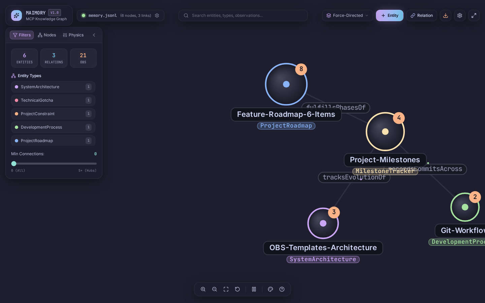

# Maimory (MCP Memory Knowledge Graph)

> **Eye-Candy visual interactive knowledge map for `@modelcontextprotocol/server-memory` styled in the authentic Catppuccin Mocha palette.**



---

## ✨ Features

- 🎨 **Authentic Catppuccin Mocha Aesthetic**:
  - Deep dark background (`#1e1e2e` Base, `#181825` Mantle, `#11111b` Crust)
  - Glassmorphic floating HUD panels with blur and subtle borders
  - Semantic entity colors (Mauve for Architecture, Red for Gotchas/Bugs, Peach for Constraints, Green for Processes, Blue for Roadmaps, Yellow for Milestones, Teal for Features)
  - Neon halos, glowing particle flows, and focused sub-graph highlighting (dimming non-connected nodes)
- 🧠 **Direct MCP Memory Integration**:
  - Auto-locates the active MCP memory file (`memory.jsonl`) or configurable path
  - Real-time Server-Sent Events (SSE): graph updates live as MCP memory changes
  - Full CRUD: Add, edit, and delete entities, observations, and relations directly in the UI
- 🚀 **High Performance 2D Physics Graph (60 FPS)**:
  - Custom HTML5 Canvas rendering powered by `force-graph`
  - Observation count badges & degree indicators
  - Dynamic layouts: Force-Directed 2D, Radial Orbit, Top-Down Tree, and Left-Right Flow
  - Real-time physics tuning: repulsion force, link distance, flow particle speed
- 🔍 **Interactive Exploration**:
  - Instant search across entity names, entity types, and observation content
  - Smooth camera transitions (`fly-to-node` on selection)
  - Entity Inspector drawer with observation list, inline addition/editing, and clickable relation links
  - Export capabilities: PNG image snapshot, raw `memory.json`, and `memory.jsonl`

---

## 🛠️ Quick Start

### 1. Install dependencies
```bash
npm install
```

### 2. Run in Development Mode
Starts both the Express API server and Vite client concurrently with live reload:
```bash
npm run dev
```

### 3. Run in Production Mode
Builds client and server bundles and launches the unified server:
```bash
npm run build
npm start
```
The application will be accessible at **http://127.0.0.1:4321**.

---

## ⚙️ Configuration

By default, Maimory automatically detects your active `@modelcontextprotocol/server-memory` storage file. You can also specify a custom path via environment variable or in the UI settings:

```bash
# Point to a specific memory file
MEMORY_FILE_PATH=./memory.jsonl npm start
```

Or click the active memory file pill in the top navigation bar to open the **Storage Settings Modal** to switch paths or import/merge JSON/JSONL datasets.

---

## ⌨️ Keyboard Shortcuts

| Key | Action |
| --- | --- |
| `/` | Focus search bar |
| `Space` | Pause / resume physics simulation |
| `F` | Fit graph to screen |
| `Esc` | Clear selection / close inspector & modals |
| `Click Node` | Select node and open Inspector |
| `Drag Canvas` | Pan and rotate graph |
